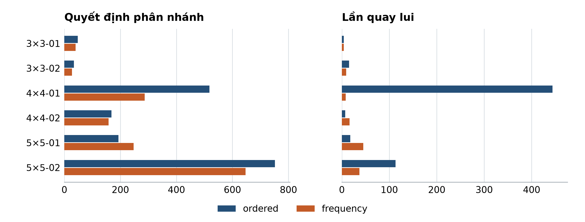
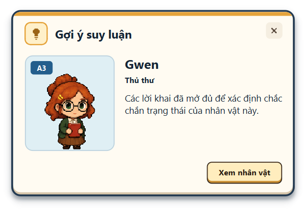
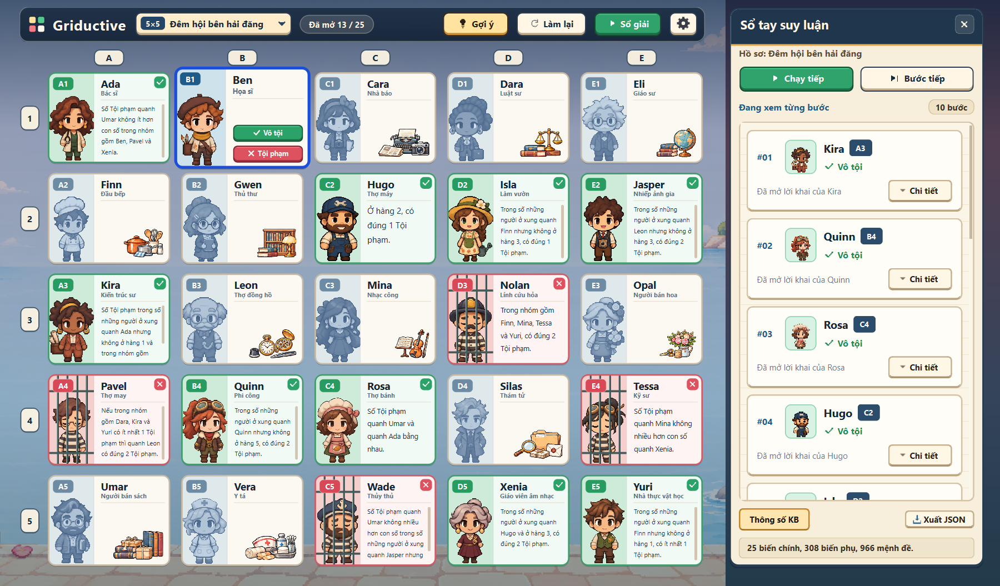

# Griductive Solver: Suy luận Không Đoán Mò bằng Mã hóa CNF và Bộ giải DPLL

**BÁO CÁO ĐỒ ÁN THỰC HÀNH 2**

Đại học Quốc gia TP.HCM · Trường Đại học Khoa học Tự nhiên · Khoa Công nghệ Thông tin · Bộ môn Công nghệ Tri thức

**CSC14003 – Nhập môn Trí tuệ Nhân tạo** · Lớp học phần **24TN**  
Thành phố Hồ Chí Minh, tháng 11 năm 2026

Phan Ngọc Thức (24120228), Nguyễn Lê Minh Quân (24120219), Tống Phúc Thiện (24120141), Bùi Phương Nam (24120502) và Phan Gia Phúc (24120503).

## 1. Kế hoạch dự án, phân công và kiến trúc hệ thống

Trong trò chơi Griductive, người chơi chỉ được mở tiếp một thẻ nghi phạm khi trạng thái của nhân vật đó là hệ quả logic bắt buộc từ các dữ kiện đã lật mở. Nhóm xây dựng chương trình áp dụng chung quy tắc không đoán mò này cho thao tác chơi tay, chức năng gợi ý và bộ giải tự động theo đề bài môn CSC14003 [1], đồng thời tham khảo cơ chế lật thẻ và tô sáng vùng của hai trò chơi gốc Griductive và Clues by Sam [2], [3].

### Kế hoạch thực hiện và mức độ hoàn thành

Trước khi chia nhánh cài đặt, nhóm thống nhất cấu trúc dữ liệu trao đổi giữa bàn chơi và bộ suy luận để ba phần việc lõi (phân giải vùng, mã hóa CNF và giải SAT bằng DPLL) có thể phát triển song song. Sau khi ghép nối các mô-đun lõi và kiểm thử chéo với bộ đánh giá ngữ nghĩa trực tiếp, nhóm hoàn thiện giao diện Desktop, chạy thực nghiệm trên sáu màn chơi chuẩn rồi tổng hợp số liệu vào báo cáo và video trình diễn.

**Phân công theo mô-đun và tỷ lệ hoàn thành**

| Thành viên | MSSV | Phần việc phụ trách | Hoàn thành |
| --- | --- | --- | --- |
| Phan Ngọc Thức | 24120228 | Kiến trúc dự án, giao diện Desktop Cozy Harbor, thực nghiệm, báo cáo và video. | 100% |
| Nguyễn Lê Minh Quân | 24120219 | Chạy thực nghiệm, đối sánh hai chiến lược chọn biến, phân tích số liệu, báo cáo và video. | 100% |
| Tống Phúc Thiện | 24120141 | Hệ thống vùng và phép toán tập hợp, hàm đánh giá ngữ nghĩa, `GameEngine` và kiểm tra nghiệm duy nhất. | 100% |
| Bùi Phương Nam | 24120502 | Bộ giải DPLL với hai chiến lược chọn biến và cơ chế suy luận phản chứng của `LogicAgent`. | 100% |
| Phan Gia Phúc | 24120503 | Cổng Tseitin, bộ đếm ngưỡng quy hoạch động và biên dịch toàn bộ mẫu manh mối sang CNF. | 100% |

Bảng phân công trên được đối chiếu trực tiếp với tệp `docs/team.json`. Theo quy định chấm điểm của đề bài, điểm cá nhân bằng điểm nhóm nhân với tỷ lệ hoàn thành (chẳng hạn nhóm đạt 9,0 điểm thì thành viên hoàn thành 90% nhận 8,1 điểm). Cả năm thành viên trong nhóm đều hoàn thành đầy đủ phần việc được giao nên cùng đạt mức 100%.

> **Video trình diễn trên Google Drive**  
> Liên kết xem: [https://drive.google.com/file/d/1Y-84FGh__BUx-dtXgX3oKmJwhWga77Ou/view?usp=sharing](https://drive.google.com/file/d/1Y-84FGh__BUx-dtXgX3oKmJwhWga77Ou/view?usp=sharing)

### Phân tách dữ liệu ẩn, công khai và luồng xử lý

**Trách nhiệm và phạm vi dữ liệu của từng thành phần**

| Thành phần | Dữ liệu nắm giữ và nhiệm vụ |
| --- | --- |
| `GameEngine` | Giữ đối tượng `PrivatePuzzle` gồm đáp án ẩn, các lời khai chưa mở và nhật ký nước đi hợp lệ. Trích xuất trạng thái công khai ở mỗi lượt kiểm tra. |
| `PublicState` | Cấu trúc dữ liệu bất biến chứa kích thước bàn, danh sách nhân vật, các trạng thái đã chứng minh và lời khai đã lật. Các từ điển và danh sách con đều bị khóa sửa đổi. |
| `LogicAgent` | Chỉ nhận `PublicState` và bộ đăng ký luật chơi để tạo công thức CNF, gọi DPLL và kết luận chấp nhận hay bác bỏ phán quyết. |
| Giao diện Desktop | Ứng dụng PySide6 (Cozy Harbor) gửi yêu cầu suy luận qua luồng nền và cập nhật hiển thị hoàn toàn dựa trên dữ liệu công khai. |

Mỗi khi người chơi chọn phán quyết cho một ô đang úp, `GameEngine` tạo bản `PublicState` tại thời điểm đó và chuyển cho một đối tượng `LogicAgent` kiểm chứng độc lập. Chỉ khi phán quyết được chứng minh là hệ quả bắt buộc, engine mới đối chiếu lại đáp án gốc để phòng trường hợp tệp câu đố mâu thuẫn, sau đó mở lời khai của ô vừa giải và ghi thêm một bước vào nhật ký. Nếu phán quyết chưa đủ cơ sở hoặc trái với dữ kiện đã mở, trạng thái bàn chơi được giữ nguyên và không tiết lộ lời khai ẩn.

Để giao diện không bị đơ khi giải các màn $5\times5$, lớp `EngineWorker` xử lý tuần tự các yêu cầu trên một luồng `QThread` riêng và trả kết quả về cửa sổ chính thông qua cơ chế signal của Qt [4]. Mỗi yêu cầu chạy trên bản sao tạm `GameEngine.fork()`, dùng chung dữ liệu câu đố gốc nhưng tách riêng từ điển trạng thái và lịch sử bước giải. Khi người chơi đổi màn hoặc bấm làm lại giữa chừng, cờ hủy sẽ dừng vòng tìm kiếm DPLL bằng ngoại lệ `SolverCancelled`, còn cặp mã phiên và mã yêu cầu giúp cửa sổ loại bỏ các kết quả cũ trả về trễ.

Cả giao diện đồ họa, công cụ chạy thực nghiệm dòng lệnh và bộ kiểm thử tự động đều gọi chung một lớp kiểm chứng trong `GameEngine`. Nhờ vậy, chuỗi bước mở thẻ và nội dung nhật ký suy luận luôn khớp nhau khi chạy trên cùng một tệp câu đố.

## 2. Mô hình hóa bài toán và ngôn ngữ manh mối

### Biến mệnh đề chính và cơ sở tri thức công khai

Xét bàn chơi kích thước $N\times N$ với $N\in\{3,4,5\}$, trong đó các cột được đánh chữ từ A ($c=1$) sang phải và các hàng được đánh số từ 1 ($r=1$) xuống dưới. Mỗi nhân vật tại hàng $r$, cột $c$ được ánh xạ tất định vào một biến mệnh đề chính $C_i$ với chỉ số $i=(r-1)N+c\in\{1,\ldots,N^2\}$ (ví dụ ô A3 trên bàn $3\times3$ ứng với biến số 7). Ta quy ước $C_i=\mathrm{True}$ khi nhân vật là tội phạm (`CRIMINAL`) và $C_i=\mathrm{False}$ khi vô tội (`INNOCENT`). Tên gọi và nghề nghiệp chỉ dùng để hiển thị hoặc nhận diện nhân vật; mọi lời khai đã lật mở đều luôn đúng, bất kể người phát biểu là tội phạm hay vô tội.

Ở bước suy luận thứ $t$, gọi $L_t$ là tập các lời khai đã mở và $S_t$ là tập các ô đã xác định trạng thái. Với mỗi $i\in S_t$, đặt literal đơn $\ell_i=C_i$ nếu ô đó là tội phạm và $\ell_i=\neg C_i$ nếu vô tội. Cơ sở tri thức công khai tại bước $t$ được biểu diễn dưới dạng hội của các mệnh đề:

$$
KB_t=\bigwedge_{q\in L_t}\operatorname{CNF}(q)\ \land\ \bigwedge_{i\in S_t}(\ell_i).
$$

Bộ suy luận duyệt các ô chưa mở theo thứ tự hàng từ trên xuống dưới, từ trái sang phải và chọn ô đầu tiên có trạng thái bị ép buộc bởi $KB_t$. Sau khi `GameEngine` xác nhận phán quyết, cả trạng thái vừa chứng minh lẫn lời khai mới lật sẽ được đưa vào $KB_{t+1}$. Quá trình lặp dừng lại khi toàn bộ $N^2$ ô đã mở, khi không còn ô nào suy ra được một cách chắc chắn, hoặc khi phát hiện $KB_t$ mâu thuẫn.

**Sáu mẫu manh mối cơ sở theo yêu cầu đề bài**

| Kiểu | Ý nghĩa logic trên một phép gán |
| --- | --- |
| `FACT` | Khẳng định trực tiếp trạng thái của một nhân vật, biểu diễn bằng $C_i$ hoặc $\neg C_i$. |
| `SAME` | Hai nhân vật có cùng trạng thái: $C_i\leftrightarrow C_j$. |
| `DIFFERENT` | Hai nhân vật có trạng thái trái ngược nhau: $C_i\oplus C_j$. |
| `EXACTLY` | Trong vùng $R$ có đúng $k$ tội phạm ($\sum_{i\in R} C_i = k$). |
| `AT_LEAST` | Trong vùng $R$ có ít nhất $k$ tội phạm ($\sum_{i\in R} C_i \ge k$). |
| `AT_MOST` | Trong vùng $R$ có nhiều nhất $k$ tội phạm ($\sum_{i\in R} C_i \le k$). |

Với ba mẫu đếm số lượng, tham số $k$ là số nguyên thỏa $0\le k\le |R|$. Cách diễn đạt “không có ai là tội phạm” được quy về $\operatorname{EXACTLY}(0,R)$; trường hợp vùng $R$ rỗng thì tổng số tội phạm trong vùng mặc định bằng 0.

### Hệ thống vùng và các phần mở rộng luật chơi

**Bốn vùng cơ sở và bốn phép mở rộng vùng**

| Kiểu vùng | Tập ô được phân giải trên bàn cờ |
| --- | --- |
| `ROW`, `COLUMN` | Toàn bộ các ô thuộc một hàng hoặc một cột hợp lệ. |
| `NEIGHBORS` | Các ô tiếp xúc ngang, dọc hoặc chéo với ô mốc (loại trừ chính ô mốc): ô góc có 3 láng giềng, ô sát biên có 5 và ô bên trong có 8. |
| `EXPLICIT` | Tập các ô phân biệt được chỉ định tường minh theo tọa độ (có thể rỗng). |
| `CORNERS` | Bốn ô nằm ở bốn góc bàn cờ. |
| `UNION`, `INTERSECTION` | Hợp hoặc giao của hai vùng con; mỗi ô trong vùng kết quả chỉ tính một lần. |
| `DIFFERENCE` | Hiệu tập hợp gồm các ô thuộc vùng bên trái nhưng không thuộc vùng bên phải. |

Bên cạnh các vùng ghép trên, nhóm cài đặt thêm hai kiểu manh mối mở rộng là `COMPARISON` và `CONDITIONAL`. Kiểu `COMPARISON` so sánh số lượng tội phạm giữa hai vùng bất kỳ theo một trong sáu toán tử $=,\ne,<,\le,>,\ge$; nếu hai vùng có ô chung thì biến của ô đó vẫn tham gia bình thường vào cả hai vế đếm. Kiểu `CONDITIONAL` biểu diễn phép kéo theo $P\to Q$ giữa hai manh mối con tùy ý (cho phép lồng nhiều tầng) và chỉ nhận giá trị sai khi tiền đề $P$ đúng nhưng kết luận $Q$ sai.

Chẳng hạn ở màn `case-3x3-01`, lời khai mở sẵn tại B1 yêu cầu có ít nhất ba tội phạm trong vùng gồm các láng giềng của A2 sau khi loại bỏ hàng 2. Phép hiệu tập hợp cho ra đúng bốn ô $\{\mathrm{A1},\mathrm{B1},\mathrm{A3},\mathrm{B3}\}$, vừa là đầu vào cho bộ đếm CNF vừa là tập ô để giao diện viền sáng khi người chơi bấm xem lời khai.

Trong mã nguồn, cơ chế đăng ký qua decorator `@register_region` và `@register_clue` ánh xạ trực tiếp tên kiểu trong tệp JSON sang lớp xử lý tương ứng, giới hạn độ sâu lồng tối đa 12 cấp để tránh đệ quy vô hạn trên dữ liệu lỗi. Nhờ tách rời từng luật thành lớp độc lập, việc bổ sung vùng hoặc kiểu manh mối mới không đòi hỏi chỉnh sửa lại bộ mã hóa CNF hay thuật toán DPLL.

## 3. Biểu diễn logic tự động và chuyển đổi sang CNF

### Biến đổi các manh mối quan hệ hai ngôi

Chương trình không lưu sẵn công thức CNF cho từng màn mà tự động biên dịch mọi lời khai đang mở. Với manh mối `SAME`, quan hệ tương đương giữa hai biến chính $C_A$ và $C_B$ được tách thành hai chiều kéo theo để loại bỏ hai trường hợp lệch trạng thái, sau đó đổi $p\to q\equiv \neg p\lor q$ để thu được dạng chuẩn hội:

$$
\begin{aligned}
\operatorname{SAME}(A,B)&\equiv C_A\leftrightarrow C_B\\
&\equiv(C_A\to C_B)\land(C_B\to C_A)\\
&\equiv(\neg C_A\lor C_B)\land(C_A\lor\neg C_B).
\end{aligned}
$$

Tương tự, manh mối `DIFFERENT` đòi hỏi đúng một trong hai người là tội phạm. Phép tuyển loại trừ tương đương với việc có ít nhất một biến đúng và không thể đồng thời cả hai cùng đúng:

$$
\begin{aligned}
\operatorname{DIFFERENT}(A,B)&\equiv C_A\oplus C_B\\
&\equiv (C_A\lor C_B)\land\neg(C_A\land C_B)\\
&\equiv (C_A\lor C_B)\land(\neg C_A\lor\neg C_B).
\end{aligned}
$$

### Ví dụ mã hóa đếm tổ hợp trực tiếp trên vùng nhỏ

Xét vùng gồm ba biến $A,B,C$ với ràng buộc có đúng $k=2$ tội phạm. Điều kiện “ít nhất 2” buộc mọi cặp 2 ô bất kỳ phải chứa ít nhất một biến đúng, còn điều kiện “nhiều nhất 2” buộc cả 3 ô không thể đồng thời là tội phạm. Kết hợp hai phần ta có công thức CNF trực tiếp:

$$
\begin{aligned}
\operatorname{EXACTLY}(2,\{A,B,C\})\equiv{}&
(A\lor B)\land(A\lor C)\land(B\lor C)\\
&{}\land(\neg A\lor\neg B\lor\neg C).
\end{aligned}
$$

Trong trường hợp tổng quát trên vùng $n$ ô, cách liệt kê tổ hợp không dùng biến phụ cần $\binom{n}{n-k+1}=\binom{n}{k-1}$ mệnh đề dương và $\binom{n}{k+1}$ mệnh đề âm, tổng cộng $\binom{n}{k-1}+\binom{n}{k+1}$ mệnh đề (quy ước hệ số bằng 0 khi chỉ số vượt ngoài phạm vi). Cách này gọn trên vùng 3 hoặc 4 ô nhưng bùng nổ tổ hợp rất nhanh khi vùng rộng: nếu $n=25$ và $k=12$, chỉ riêng một manh mối đã phát sinh tới $9\,657\,700$ mệnh đề.

### Quy hoạch động đếm ngưỡng unary và cổng Tseitin

Để giữ kích thước công thức tăng đa thức trên mọi cỡ bàn và hỗ trợ luôn phép so sánh giữa hai vùng, lớp `Encoder` xây dựng bảng quy hoạch động các biến ngưỡng unary. Gọi $T(i,k)$ là mệnh đề “có ít nhất $k$ tội phạm trong $i$ ô đầu tiên của vùng”, với điều kiện cơ sở $T(i,0)=\mathrm{True}$ và $T(i,k)=\mathrm{False}$ khi $k>i$. Khi xét thêm ô thứ $i$ (ứng với biến $C_i$), ngưỡng $k$ đạt được khi $i-1$ ô trước đã đủ $k$ tội phạm, hoặc đã đủ $k-1$ tội phạm và bản thân $C_i$ là tội phạm:

$$
T(i,k)\leftrightarrow T(i-1,k)\lor\bigl(C_i\land T(i-1,k-1)\bigr).
$$

Mỗi ô trạng thái $(i,k)$ chỉ tạo tối đa một cổng `AND` và một cổng `OR` hai đầu vào, nên số biến phụ và số mệnh đề cho vùng $n$ ô chỉ có độ phức tạp $O(n^2)$. Các biến phụ được cấp phát liên tiếp từ $N^2+1$ trong cùng một `Encoder` của $KB_t$. Trước khi cấp biến mới, hàm `gate()` tự rút gọn hằng Boolean, khử literal trùng, triệt tiêu cặp đối dấu và tra bảng băm để dùng lại biến phụ cho các biểu thức con trùng nhau.

Theo phép biến đổi Tseitin [5], mỗi biến phụ đầu ra được ràng buộc tương đương hai chiều với cổng logic của nó để vẫn giữ nguyên ngữ nghĩa khi đặt dưới phép phủ định. Với $z\leftrightarrow(a\land b)$ và $w\leftrightarrow(a\lor b)$, các mệnh đề tương ứng là:

$$
\begin{aligned}
&(\neg z\lor a)\land(\neg z\lor b)\land(z\lor\neg a\lor\neg b),\\
&(w\lor\neg a)\land(w\lor\neg b)\land(\neg w\lor a\lor b).
\end{aligned}
$$

Ký hiệu $T_R(k)=T(|R|,k)$ tại dòng cuối của vùng $R$. Khi đó `AT_LEAST`, `AT_MOST` và `EXACTLY` lần lượt trả về $T_R(k)$, $\neg T_R(k+1)$ và cổng hội của $T_R(k)$ với $\neg T_R(k+1)$. Ở mức ngoài cùng của mỗi lời khai đã mở, bộ mã hóa thêm mệnh đề đơn ép đầu ra của lời khai mang giá trị đúng (nếu biểu thức rút gọn thành hằng `False` thì sinh mệnh đề rỗng để báo mâu thuẫn).

### Mã hóa các manh mối mở rộng và kiểm chứng độc lập

Với manh mối `COMPARISON`, số tội phạm trong vùng $R_1$ lớn hơn hoặc bằng vùng $R_2$ khi và chỉ khi mọi mức ngưỡng $k\ge 1$ đạt được trên $R_2$ cũng đồng thời đạt được trên $R_1$:

$$
\bigwedge_{k=1}^{|R_2|}\bigl(\neg T_{R_2}(k)\lor T_{R_1}(k)\bigr).
$$

Từ biểu thức $\ge$ này, chương trình suy ra $\le$ bằng cách hoán vị hai vùng, tạo dấu $=$ bằng hội hai chiều, và lấy phủ định để biểu diễn $\ne$, $<$ cùng $>$. Với `CONDITIONAL`, bộ mã hóa đệ quy sinh literal đại diện cho hai vế $r_{\mathrm{if}},r_{\mathrm{then}}$ rồi ghép cổng $\neg r_{\mathrm{if}}\lor r_{\mathrm{then}}$. Song song với nhánh CNF, mỗi lớp manh mối đều cài đặt hàm `evaluate()` kiểm tra trực tiếp tính đúng/sai trên phép gán đầy đủ bằng phép đếm và so sánh Python thuần để bộ kiểm thử đối chiếu chéo hai cách cài đặt.

## 4. Thuật toán DPLL, suy luận phản chứng và kiểm tra nghiệm duy nhất

### Thủ tục tìm mô hình DPLL

Bộ giải SAT trong `sat.py` được nhóm tự cài đặt theo thuật toán Davis–Putnam–Logemann–Loveland [6]. Ở bước tiền xử lý, hàm `solve()` loại bỏ các literal trùng trong cùng một mệnh đề, lược bỏ các mệnh đề hằng đúng (chứa cả $v$ và $-v$) và nối các giả định tạm thời (`assumptions`) dưới dạng các mệnh đề đơn. Trong cây đệ quy, mỗi nhánh con thao tác trên bản sao phép gán riêng để khi quay lui không làm ảnh hưởng nhánh anh em.

**DPLL-Solve với hai chiến lược chọn biến**

```text
Đầu vào: Công thức CNF F, tổng số biến m, phép gán A (khởi tạo rỗng), chiến lược h
Lặp
  Kiểm tra cờ hủy và hạn thời gian; nếu F chứa mệnh đề rỗng thì trả UNSAT.
  Thu thập danh sách U các literal nằm trong mệnh đề đơn; nếu U = ∅ thì thoát vòng lặp.
  Với mỗi ℓ ∈ U
    Nếu ℓ ngược giá trị đã có trong A thì trả UNSAT; nếu biến chưa gán thì ghi vào A và cộng 1 vào bộ đếm lan truyền.
  Rút gọn F theo A: xóa mệnh đề đã thỏa và bỏ các literal sai khỏi mệnh đề còn lại.
Nếu F rỗng
  Gán mặc định False cho các biến tự do chưa có trong 1,…,m; trả SAT kèm mô hình.
Thống kê số lần xuất hiện (gộp cả hai chiều âm dương) của từng biến còn lại trong F.
Nếu h = ordered chọn biến có chỉ số nhỏ nhất; nếu h = frequency chọn biến có tần suất cao nhất (hòa chọn chỉ số nhỏ nhất). Gọi biến được chọn là v.
Cộng 1 vào bộ đếm quyết định.
Với b lần lượt nhận giá trị True, False
  Tạo bản sao A' = A ∪ {v ↦ b}, rút gọn F theo A' và gọi đệ quy DPLL-Solve.
  Nếu nhánh con trả SAT thì trả ngay mô hình; nếu thất bại thì cộng 1 vào bộ đếm quay lui.
Trả UNSAT.
```

Nếu hai mệnh đề đơn mang literal đối nhau xuất hiện trong cùng đợt lan truyền, xung đột được phát hiện ngay khi gán vào $A$. Khi mọi mệnh đề đều đã thỏa mãn, các biến chưa xuất hiện hoặc đã được khử có thể nhận giá trị `False` tùy ý mà không làm sai công thức. Phép gán tại nút phân nhánh được áp trực tiếp vào $A'$ thay vì chèn mệnh đề đơn giả, nhờ đó bộ đếm `propagations` chỉ phản ánh đúng các phép gán bị ép buộc.

### Kiểm chứng phán quyết bằng phản chứng và lưu mô hình nhân chứng

Để tránh suy diễn sai từ một cơ sở tri thức mâu thuẫn, `LogicAgent` luôn kiểm tra $KB_t$ khả thỏa trước tiên. Khi $KB_t$ khả thỏa, giả thiết phủ định $KB_t\land\neg C_i$ vô nghiệm chứng tỏ mọi mô hình hợp lệ đều có $C_i=\mathrm{True}$, nên ô $i$ chắc chắn là tội phạm; ngược lại $KB_t\land C_i$ vô nghiệm chứng tỏ ô $i$ vô tội. Nếu cả hai truy vấn đều khả thỏa, mỗi mô hình tìm được là một phản ví dụ cụ thể cho thấy trạng thái của ô $i$ vẫn còn `UNKNOWN`.

**Phân loại các ô chưa mở và kiểm chứng đề nghị**

```text
Đầu vào: Trạng thái công khai PublicState; chế độ phân loại hoặc kiểm chứng literal đề nghị p
Dựng KB_t và gọi DPLL không giả định; nếu UNSAT thì trả INCONSISTENT.
Nếu chế độ verify
  Nếu KB_t ∧ ¬p trả UNSAT thì trả ACCEPTED.
  Nếu KB_t ∧ p trả UNSAT thì trả CONTRADICTED; ngược lại trả NOT_PROVABLE.
Từ mô hình cơ sở ban đầu, đánh dấu giá trị chân trị (True/False) đã xuất hiện của mọi biến chính.
Với mỗi ô chưa mở theo thứ tự hàng
  Nếu biến C_i đã xuất hiện đủ cả hai giá trị True và False trong các mô hình trước đó, kết luận UNKNOWN và chuyển sang ô kế tiếp.
  Gọi ℓ là chiều giá trị chưa có mô hình nhân chứng; giải KB_t ∧ ℓ.
  Nếu kết quả là UNSAT
    Kết luận CRIMINAL nếu ℓ = ¬C_i, ngược lại kết luận INNOCENT.
  Ngược lại
    Cập nhật giá trị chân trị của toàn bộ biến chính từ mô hình mới và kết luận UNKNOWN.
```

Nhờ tận dụng lại các mô hình trả về trong hàm `LogicAgent._verdicts`, mô hình cơ sở đầu tiên đã cung cấp sẵn ít nhất một giá trị thỏa mãn cho mọi biến chính trên bàn. Do đó với mỗi ô chưa mở, bộ giải chỉ tốn tối đa một truy vấn SAT bổ sung (và không tốn thêm truy vấn nào nếu hai mô hình trước đó đã cho cả hai giá trị trái ngược ở ô ấy). Hai tập đánh dấu này chỉ dùng nội bộ trong lượt duyệt $KB_t$ hiện hành, còn hàm `verify()` khi kiểm tra nước đi lẻ của người chơi vẫn thực hiện độc lập các truy vấn cần thiết.

Xét ví dụ đề bài với $KB=(C_A\lor C_B)\land(\neg C_A\lor C_B)$: khi thêm giả định $\neg C_B$, lan truyền đơn thu được đồng thời $C_A$ và $\neg C_A$ gây mâu thuẫn, nên $B$ bắt buộc là tội phạm. Ngược lại, cả hai phép gán $(C_A=\mathrm{True}, C_B=\mathrm{True})$ và $(C_A=\mathrm{False}, C_B=\mathrm{True})$ đều thỏa $KB$, nên trạng thái của $A$ vẫn là `UNKNOWN` và thẻ $A$ được giữ nguyên úp.

### Vòng lặp mở thẻ, nhật ký suy luận và kiểm tra nghiệm duy nhất

Trong chế độ giải từng bước, `next_verdict()` dừng ngay tại nhân vật đầu tiên tìm được kết luận chắc chắn: `hint()` chỉ báo vị trí ô này cho người chơi, còn `step()` chuyển phán quyết qua `submit()` để xác minh lại và lật thẻ. Mỗi bước được chấp nhận đều lưu vào `trace` đầy đủ số thứ tự bước, tọa độ ô, phán quyết, danh sách ID lời khai đang mở trước bước đó, chi tiết từng truy vấn SAT và nội dung lời khai mới vừa lật. Nếu toàn bộ các ô còn lại đều trả về `UNKNOWN`, vòng tự giải dừng an toàn mà không đoán mò.

Đối chiếu tệp nhật ký thực tế của màn `case-3x3-01` với cấu hình `ordered`: ở bước 1 chỉ có hai lời khai mở sẵn là B1 và C1, tạo thành $KB_1$ gồm 9 biến chính, 39 biến phụ và 123 mệnh đề. Truy vấn kiểm tra $KB_1$ cho kết quả SAT, sau đó truy vấn giả định $-7$ (giả sử nhân vật ở A3 vô tội) trả về UNSAT sau 46 phép lan truyền đơn mà không cần phân nhánh, từ đó chứng minh A3 là tội phạm và mở lời khai A3 cho bước thứ hai.

Khác với vòng chơi trực tuyến chỉ đọc dữ liệu công khai, hàm ngoại tuyến `check_uniqueness()` kiểm tra xem toàn bộ $N^2$ lời khai của tệp câu đố có xác định duy nhất một nghiệm nhân vật hay không. Sau khi mã hóa tất cả lời khai thành công thức $F$ và tìm mô hình đầu tiên $M$ (nếu vô nghiệm thì trả `INCONSISTENT`), chương trình ghép thêm mệnh đề chặn $B_M$ chỉ lấy trên tập biến chính $P=\text{kb.primary.values()}$:

$$
B_M=\bigvee_{v\in P}\begin{cases}\neg v,&M(v)=\mathrm{True},\\v,&M(v)=\mathrm{False}.\end{cases}
$$

Mệnh đề $B_M$ ép mọi nghiệm mới của $F\land B_M$ phải khác $M$ tại ít nhất một nhân vật trên bàn. Nếu truy vấn thứ hai trả UNSAT thì câu đố đạt `UNIQUE`, ngược lại nếu trả SAT thì câu đố bị đa nghiệm (`MULTIPLE`). Việc giới hạn $B_M$ trên tập biến chính giúp tránh đếm nhầm hai mô hình chỉ khác nhau ở giá trị biến phụ Tseitin không ràng buộc. Cần lưu ý rằng một câu đố đạt `UNIQUE` khi gộp đủ mọi thẻ vẫn có thể bị tắc ở giữa chừng nếu thiếu điểm mở đầu, nên khả năng giải tuần tự từ tập thẻ mở sẵn luôn được kiểm tra riêng bằng vòng suy luận công khai.

### Bộ kiểm thử tự động

Toàn bộ dự án được kiểm tra hồi quy qua lệnh `python -B -m unittest discover -s tests -v` với 87 bài kiểm thử thuộc 13 mô-đun đều vượt qua. Các bài kiểm thử lõi đối chiếu vét cạn hàm `evaluate()` với kết quả giải CNF trên mọi phép gán biến chính, đồng thời kiểm tra lan truyền đơn, quay lui, điều kiện lồng nhiều cấp, vùng rỗng và đăng ký luật mới. Các mô-đun còn lại kiểm tra tính bất biến của `PublicState`, từ chối nước đi đoán mò, hủy tác vụ trên worker nền, chạy bộ thực nghiệm và hiển thị giao diện.

## 5. Thực nghiệm và đánh giá hai chiến lược chọn biến

Nhóm đánh giá hệ thống bằng cách chạy tự động cả hai chiến lược phân nhánh của DPLL (`ordered` và `frequency`) trên cùng bộ sáu câu đố chuẩn theo thứ tự cố định, gồm hai màn $3\times3$, hai màn $4\times4$ và hai màn kiểm tra tải $5\times5$. Toàn bộ 12 lượt chạy chính thức được thực hiện trên cùng một máy tính dùng Windows 11, Python 3.14.6 và vi xử lý Intel Core i5-12450HX.

**Trạng thái kết thúc, quy mô KB cuối phiên và số bước suy luận**

| Màn | Chiến lược | N | Trạng thái | Nghiệm | Biến chính | Biến phụ | Mệnh đề | Bước |
| --- | --- | --- | --- | --- | --- | --- | --- | --- |
| case-3x3-01 | ordered | 3 | SOLVED | UNIQUE | 9 | 156 | 491 | 7 |
| case-3x3-01 | frequency | 3 | SOLVED | UNIQUE | 9 | 156 | 491 | 7 |
| case-3x3-02 | ordered | 3 | SOLVED | UNIQUE | 9 | 144 | 455 | 7 |
| case-3x3-02 | frequency | 3 | SOLVED | UNIQUE | 9 | 144 | 455 | 7 |
| case-4x4-01 | ordered | 4 | SOLVED | UNIQUE | 16 | 364 | 1138 | 13 |
| case-4x4-01 | frequency | 4 | SOLVED | UNIQUE | 16 | 364 | 1138 | 13 |
| case-4x4-02 | ordered | 4 | SOLVED | UNIQUE | 16 | 273 | 862 | 13 |
| case-4x4-02 | frequency | 4 | SOLVED | UNIQUE | 16 | 273 | 862 | 13 |
| case-5x5-01 | ordered | 5 | SOLVED | UNIQUE | 25 | 668 | 2068 | 22 |
| case-5x5-01 | frequency | 5 | SOLVED | UNIQUE | 25 | 668 | 2068 | 22 |
| case-5x5-02 | ordered | 5 | SOLVED | UNIQUE | 25 | 654 | 2045 | 22 |
| case-5x5-02 | frequency | 5 | SOLVED | UNIQUE | 25 | 654 | 2045 | 22 |

**Chi phí tìm kiếm DPLL và thời gian chạy của từng cấu hình**

| Màn | Chiến lược | Gọi SAT | Quyết định | Lan truyền | Quay lui | Thời gian (s) |
| --- | --- | --- | --- | --- | --- | --- |
| case-3x3-01 | ordered | 34 | 48 | 2944 | 4 | 0.0469 |
| case-3x3-01 | frequency | 33 | 40 | 2942 | 4 | 0.0598 |
| case-3x3-02 | ordered | 30 | 34 | 2802 | 15 | 0.0708 |
| case-3x3-02 | frequency | 30 | 27 | 2693 | 9 | 0.0511 |
| case-4x4-01 | ordered | 84 | 518 | 29666 | 444 | 1.0145 |
| case-4x4-01 | frequency | 85 | 287 | 18887 | 8 | 0.5043 |
| case-4x4-02 | ordered | 93 | 168 | 12568 | 7 | 1.1509 |
| case-4x4-02 | frequency | 91 | 158 | 12567 | 16 | 1.0898 |
| case-5x5-01 | ordered | 162 | 193 | 43608 | 18 | 3.4830 |
| case-5x5-01 | frequency | 164 | 247 | 44288 | 45 | 3.5915 |
| case-5x5-02 | ordered | 182 | 752 | 55976 | 113 | 6.4323 |
| case-5x5-02 | frequency | 182 | 647 | 53655 | 37 | 5.5400 |

Số lần gọi SAT và ba bộ đếm DPLL cộng gộp cả các truy vấn dò bước đi của `LogicAgent` lẫn các truy vấn xác minh độc lập trong `GameEngine.submit`. Cột thời gian đo trọn vòng dựng KB và mở thẻ (làm tròn $10^{-4}$ giây từ tệp gốc `output/experiments/results.json`); riêng bước kiểm tra `check_uniqueness` chạy sau khi dừng đồng hồ nên không tính vào chi phí phiên giải.

### So sánh hành vi phân nhánh trên cùng câu đố



*Số quyết định phân nhánh và số lần quay lui của hai chiến lược (hai biểu đồ dùng thang trục ngang riêng).*

Sự khác biệt rõ nhất xuất hiện ở màn `case-4x4-01`: khi chuyển từ `ordered` sang `frequency`, số quyết định phân nhánh giảm từ 518 xuống 287 và số lần quay lui giảm mạnh từ 444 xuống chỉ còn 8 lần, dù tổng số truy vấn SAT nhích từ 84 lên 85. Kiểm tra tại KB mở đầu cho thấy `ordered` phân nhánh ngay vào biến số 1 (chỉ xuất hiện 4 lần trong công thức đã rút gọn), trong khi `frequency` chọn biến số 11 (biến chính của một ô nằm giao nhiều vùng đếm, xuất hiện tới 24 lần). Việc gán sớm biến tham gia nhiều ràng buộc giúp kích hoạt dây chuyền lan truyền đơn qua các ngưỡng đếm và phát hiện nhánh vô nghiệm sớm hơn.

Trong cách cài đặt hiện tại, các biến phụ Tseitin cũng được tính tần suất cùng với biến chính. Một biến ngưỡng dùng chung ở nhiều cổng so sánh thường xuất hiện dày trong mệnh đề và khi được gán sẽ kéo theo nhiều ràng buộc con. Trên màn tải nặng `case-5x5-02`, với cùng 182 lần gọi SAT, `frequency` hạ số quyết định từ 752 xuống 647, giảm số lần quay lui từ 113 xuống 37 và rút ngắn thời gian chạy từ 6,4323 giây xuống còn 5,5400 giây.

Tuy nhiên, ưu tiên tần suất cao không phải lúc nào cũng thắng thế. Ở màn `case-5x5-01`, `ordered` chỉ tốn 193 quyết định và 18 lần quay lui, còn `frequency` tăng lên 247 quyết định và 45 lần quay lui. Ngay ở truy vấn đầu tiên của màn này, `ordered` chọn biến số 4 và tìm ra nghiệm thỏa mãn sau hai lần rẽ nhánh, trong khi `frequency` chọn biến số 18 nhưng nhánh thử `True` đầu tiên lại dẫn vào ngõ cụt phải quay lui. Vì cả hai chiến lược đều cố định thứ tự thử `True` trước `False`, việc chọn biến có mặt ở nhiều mệnh đề vẫn có thể đẩy bộ giải đi sâu vào một nhánh vô nghiệm trước khi đảo giá trị.

### Thời gian chạy, quy mô CNF và hạn chế của hệ thống


*Thời gian giải toàn màn và tổng số mệnh đề trong KB cuối phiên.*

Kích thước bàn cờ không phải yếu tố duy nhất quyết định thời gian chạy. Hai màn $5\times5$ đều mở 22 thẻ và kết thúc với quy mô KB xấp xỉ nhau (2 068 và 2 045 mệnh đề), nhưng `case-5x5-02` đòi hỏi nhiều phép phân nhánh hơn hẳn nên tốn khoảng 5,54–6,43 giây so với mức 3,48–3,59 giây của `case-5x5-01`. Trên `case-4x4-01`, việc cắt giảm gần như toàn bộ quay lui giúp `frequency` giảm một nửa thời gian (từ 1,0145 xuống 0,5043 giây), trong khi ở các màn $3\times3$ thời gian dưới 0,08 giây nên chênh lệch chủ yếu đến từ chi phí đếm lại tần suất biến và dao động hệ điều hành.

Ngoài ra, khi hai chiến lược tìm ra các mô hình thỏa mãn khác nhau ở bước đầu, tập giá trị `True`/`False` ghi nhận sẵn cho các biến chính cũng khác nhau, dẫn tới số truy vấn SAT có thể chênh 1–2 lần dù cả hai vẫn mở cùng thứ tự thẻ. Chẳng hạn tại `case-4x4-02`, `frequency` giảm nhẹ số quyết định (158 so với 168) và số lần gọi SAT (91 so với 93) nhưng lại quay lui nhiều hơn (16 so với 7), cho thấy cần quan sát đồng thời nhiều chỉ số thay vì chỉ nhìn riêng số bước hay số mệnh đề.

Về các trường hợp biên và thất bại theo mục 4.5, cả 12 lượt chạy chuẩn đều đạt `SOLVED` và kiểm định ngoại tuyến đạt `UNIQUE`. Khi gặp câu đố thiếu dữ kiện mở đường hoặc mâu thuẫn, vòng lặp trả về `UNKNOWN` hoặc `INCONSISTENT` và giữ nguyên dòng kết quả trong tệp xuất thay vì loại bỏ. Hạn thời gian mặc định của bộ thực nghiệm là 30 giây cho mỗi màn (kiểm tra giữa các bước mở thẻ, kết hợp hạn riêng trên từng truy vấn SAT) để ghi nhận trạng thái `TIMEOUT` nếu quá hạn.

Hạn chế chính của bộ giải hiện tại nằm ở cấu trúc dữ liệu của DPLL thuần Python: mỗi bước lan truyền đơn và rút gọn nhánh đều duyệt lại danh sách mệnh đề và sao chép các bộ literal, chưa áp dụng kỹ thuật hai literal canh (*two-watched literals*) hay cơ chế học mệnh đề xung đột và quay lui phi tuần tự như các bộ giải CDCL hiện đại. Bên cạnh đó, mỗi cấu hình mới đo một lượt trên sáu màn đại diện nên phù hợp để phân tích hành vi cắt nhánh tất định hơn là kết luận thống kê cho các lưới kích thước lớn hơn $5\times5$.

## 6. Giao diện người dùng Desktop Cozy Harbor

### Chọn hồ sơ vụ án và chơi thủ công

Giao diện Desktop được thiết kế theo phong cách phố biển sáng (Cozy Harbor), hiển thị trực quan nhãn cột/hàng, chân dung pixel, tên, nghề nghiệp, huy hiệu trạng thái đã chứng minh và nội dung lời khai trên từng thẻ mở. Từ nút chọn vụ án trên thanh tiêu đề, người chơi chuyển nhanh giữa sáu màn chuẩn chia theo ba cỡ bàn hoặc nạp một tệp câu đố JSON bên ngoài. Khi bấm vào thẻ nghi phạm đang úp, hai nút phán quyết xuất hiện ngay trên thẻ; chỉ khi suy luận phản chứng thành công, thẻ mới lật mở lời khai tiếp theo.


*Menu chọn hồ sơ vụ án trên bàn 3×3, phân nhóm theo kích thước bàn cờ.*

Nút “Gợi ý” gọi `GameEngine.hint()` trên trạng thái công khai hiện thời để tìm nhân vật đầu tiên đã đủ cơ sở chứng minh mà không chạm tới đáp án ẩn. Hộp thoại gợi ý có nút “Xem nhân vật” đưa tiêu điểm tới ô tương ứng nhưng giữ nguyên thẻ ở trạng thái úp để người chơi tự suy nghĩ và ra quyết định.



*Hộp thoại gợi ý chỉ tới Gwen (thủ thư tại ô A3) khi các lời khai hiện có đã buộc được trạng thái của ô này.*

### Tô sáng vùng tham chiếu và theo dõi Sổ giải


*Bàn 4×4 khi chọn đọc một lời khai: viền màu làm nổi bật vùng tham chiếu, các thẻ ngoài vùng được làm mờ nhẹ.*

Đối với những lời khai ghép nhiều vùng hoặc có điều kiện lồng, mỗi cụm từ chỉ vùng hay nhân vật trong câu chữ đều mang màu khớp với viền khung trên bàn cờ. Người chơi có thể di chuột qua hoặc bấm ghim từng cụm từ để tách riêng toán hạng trái, toán hạng phải của phép so sánh. Nút “Tự động giải” mở lần lượt các bước đã chứng minh, còn nút “Làm lại” đưa màn chơi về các thẻ mở ban đầu.



*Bàn 5×5 mở kèm bảng Sổ giải ở cạnh phải, ghi lại từng bước chứng minh và truy vấn DPLL.*

### Điều phối luồng nền, nạp tệp JSON và xuất nhật ký

Cửa sổ chính đặt bàn chơi trên `QMainWindow` và bố trí Sổ giải dưới dạng bảng neo `QDockWidget` ở cạnh phải [7]. Bảng này ẩn mặc định để dành trọn không gian cho bàn cờ khi người chơi tự suy luận, và chỉ mở ra khi bấm “Sổ giải” hoặc “Tự động giải”. Nếu đóng Sổ giải khi chế độ tự động đang chạy, bộ hẹn giờ sẽ tự tạm dừng ngay để tránh mở tiếp các thẻ khi người dùng không theo dõi.

Lớp `GameController` quản lý đồng bộ giữa giao diện và luồng tính toán bằng cách gắn một mã phiên (`generation`) cho mỗi lần nạp hoặc khởi động lại màn, kèm mã yêu cầu tăng dần cho từng thao tác gợi ý, gửi phán quyết hay giải từng bước. Trên luồng `EngineWorker`, mọi phép gọi SAT đều thực hiện trên bản sao `GameEngine.fork()` rồi mới gửi kết quả cùng số liệu KB về luồng giao diện. Nhờ kết hợp cờ hủy trong DPLL với kiểm tra mã phiên ở đầu nhận, việc chuyển nhanh sang màn khác khi đang giải bàn lớn không gây xung đột dữ liệu.

Khi người dùng nạp tệp JSON tùy chỉnh từ hộp thoại mở tệp, hàm `load_puzzle` kiểm tra đầy đủ phiên bản cấu trúc, kích thước $N\in\{3,4,5\}$, quy tắc xếp tên theo thứ tự bảng chữ cái từng hàng, tính hợp lệ của các vùng và sự nhất quán của toàn bộ lời khai đối với nghiệm chuẩn trước khi khởi tạo phiên mới. Nếu tệp đầu vào sai định dạng hoặc chứa lời khai mâu thuẫn, chương trình báo lỗi rõ vị trí trường hỏng và giữ nguyên ván chơi hiện tại.

Ở cuối Sổ giải, nút “Thông số KB” cho xem nhanh số biến chính, biến phụ Tseitin và tổng số mệnh đề CNF ở trạng thái hiện hành, còn nút “Xuất JSON” lưu toàn bộ danh sách `engine.trace` ra tệp ngoài. Định dạng tệp xuất trùng khớp với các tệp nhật ký trong `output/experiments/`, thuận tiện cho việc kiểm tra lại từng giả định UNSAT của một bước giải bất kỳ.

## Tài liệu tham khảo

1. Khoa Công nghệ Thông tin, Trường Đại học Khoa học Tự nhiên, ĐHQG-HCM. Đề đồ án học phần, mục 4.1–4.7, trang 5–8. CSC14003: Introduction to Artificial Intelligence. Project 2: Griductive Solver.
2. Knotwise Games. [Griductive: How to Play](https://knotwise.games/games/griductive/how-to-play).
3. Clues by Sam. [Clues by Sam](https://cluesbysam.com/).
4. The Qt Company. [Qt for Python 6: QThread](https://doc.qt.io/qtforpython-6/PySide6/QtCore/QThread.html).
5. G. S. Tseitin. Automation of Reasoning, tập 2, Springer, 1983, tr. 466–483. [On the Complexity of Derivation in Propositional Calculus](https://doi.org/10.1007/978-3-642-81955-1_28).
6. Martin Davis, George Logemann và Donald Loveland. Communications of the ACM, 5(7), 1962, tr. 394–397. [A Machine Program for Theorem-Proving](https://doi.org/10.1145/368273.368557).
7. The Qt Company. [Qt for Python 6: QMainWindow and QDockWidget](https://doc.qt.io/qtforpython-6/PySide6/QtWidgets/QMainWindow.html).
8. Stable Diffusion v1.5. [Stable Diffusion Inpainting: Model Card](https://huggingface.co/stable-diffusion-v1-5/stable-diffusion-inpainting).
9. gamedev-skills. [Awesome Gamedev Agent Skills](https://github.com/gamedev-skills/awesome-gamedev-agent-skills).
10. safina57. [Clues by Sam Solver](https://github.com/safina57/clues-by-sam-solver).
11. TranTai35. [Griductive Solver](https://github.com/TranTai35/griductive-solver).
12. WadeWartz. [Griductive-Solver](https://github.com/WadeWartz/Griductive-Solver).

## A. Phụ lục về việc sử dụng công cụ AI tạo sinh

### Hỗ trợ tra cứu kỹ thuật, giao diện và kiểm thử biên

Theo quy định của đề bài, toàn bộ các mô-đun thuật toán cốt lõi trong `griductive/engine/` — gồm phân giải vùng, đánh giá ngữ nghĩa trực tiếp, mã hóa CNF bằng cổng Tseitin với quy hoạch động đếm ngưỡng unary, bộ giải DPLL và cơ chế suy luận phản chứng của `LogicAgent` — đều do các thành viên trong nhóm tự thiết kế, cài đặt và đối chiếu theo phân công tại Bảng 1. Trong quá trình phát triển phần phụ trợ, nhóm sử dụng mô hình ngôn ngữ lớn như một trợ lý tra cứu API giao diện PySide6 (tổ chức bố cục co giãn, vẽ thẻ tùy biến, giao tiếp `QThread` qua signal), gợi ý thêm các ca kiểm thử biên và rà soát lỗi trình bày tài liệu.

Khi đặt câu hỏi cho công cụ AI, nhóm luôn nêu rõ ràng buộc đầu vào công khai và tự kiểm tra lại bằng mã kiểm thử độc lập thay vì chép nguyên đoạn mã sinh tự động. Chẳng hạn, một yêu cầu gợi ý ca kiểm thử biên được đặt như sau: *“Đề xuất các trường hợp biên dễ sót khi kiểm thử bộ phân giải vùng tập hợp (UNION, INTERSECTION, DIFFERENCE) và manh mối CONDITIONAL lồng nhau trên lưới $N\times N$, sao cho có thể kiểm tra chéo giữa hàm evaluate() trực tiếp và nghiệm của công thức CNF.”* Từ danh sách gợi ý, nhóm chọn lọc và tự viết các bài kiểm thử vét cạn bảng chân trị trên bàn nhỏ, kiểm tra vùng hiệu rỗng, giới hạn độ sâu lồng 12 cấp và đối chiếu từng bước trên nhật ký thực nghiệm thật.

### Tạo tài sản đồ họa nhân vật và kiểm định khung hình

Để xây dựng bộ hình ảnh thống nhất cho 25 nhân vật và 25 nghề nghiệp mà không lấy tài sản từ trò chơi thương mại, nhóm sử dụng công cụ sinh ảnh kết hợp chỉnh sửa vùng chọn (*inpainting*) và lưu lại nhật ký câu lệnh trong `docs/AI-PROMPTS.md`. Một đoạn câu lệnh tiếng Anh dùng để giữ cố định vị trí khuôn mặt giữa các khung biểu cảm của nhân vật Ada là: *“keep face center, eye line, head scale, hair silhouette and shoulders in exactly same position across all frames, transparent RGBA background”*.

Với các khung nhắm mắt chớp tự nhiên, nhóm dùng mô hình Stable Diffusion 1.5 Inpainting [8] kèm mặt nạ chỉ khoanh vùng mí mắt để giữ nguyên toàn bộ điểm ảnh trang phục và kênh alpha bên ngoài mặt nạ. Sau bước đóng gói vào atlas `assets/characters/pixel/sprites.png` ($25\times7$ ô kích thước $256\times256$), nhóm viết mô-đun `test_sprite_registration.py` kiểm tra tự động đường viền trong suốt 8 pixel ở bốn cạnh mỗi ô và độ lệch chiều cao giữa các tư thế không vượt quá ngưỡng cho phép. Toàn bộ hình chụp trong mục 6 đều được chụp trực tiếp từ cửa sổ chương trình khi đang chạy thật.

### Tổng hợp giọng đọc thuyết minh và đối chiếu nguồn tham khảo

Trong khâu dựng video trình diễn, nhóm viết kịch bản thuyết minh tiếng Việt theo sáu phần tương ứng với các thao tác trên giao diện, sau đó dùng dịch vụ chuyển văn bản thành giọng nói (ElevenLabs TTS) để sinh 16 đoạn âm thanh khớp thời lượng với hình quay màn hình 24 khung/giây và chèn phụ đề tiếng Việt. Công cụ âm thanh và hình ảnh chỉ phục vụ phần trình bày trực quan; mọi kết quả gợi ý, từ chối phán quyết hay tự giải xuất hiện trên video đều do chính bộ giải DPLL của chương trình tính toán trực tiếp.

Danh sách đầy đủ các tài liệu và kho mã mở mà nhóm đã đọc khảo sát được ghi nhận tại `docs/REFERENCES.md`, bao gồm bộ hướng dẫn bố cục trò chơi giải đố [9] và ba dự án mã mở cùng chủ đề [10], [11], [12]. Qua khảo sát, nhóm nhận thấy có dự án ngoài dùng thư viện Z3 hoặc còn chứa màn chơi đa nghiệm, do đó nhóm chỉ tham khảo cách tổ chức trạng thái tổng quát và tự xây dựng toàn bộ bộ câu đố cũng như thuật toán CNF/DPLL đáp ứng đúng yêu cầu của học phần.
