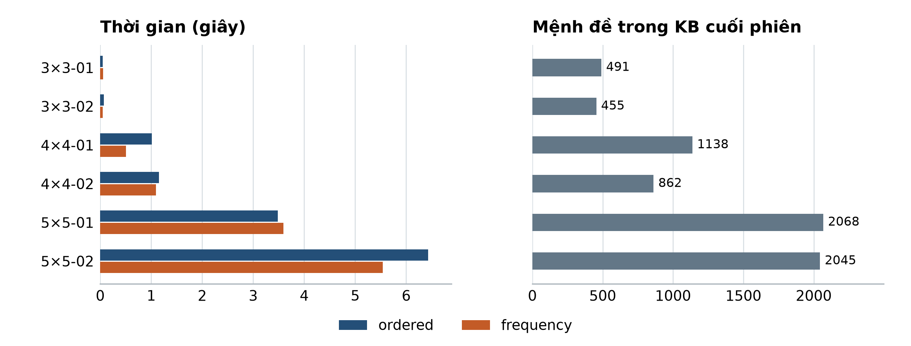
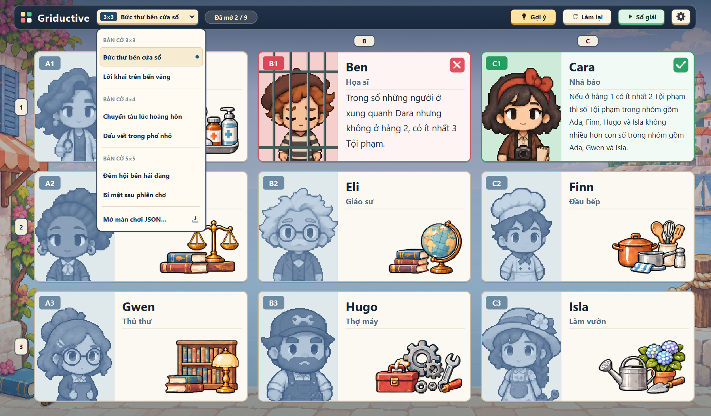
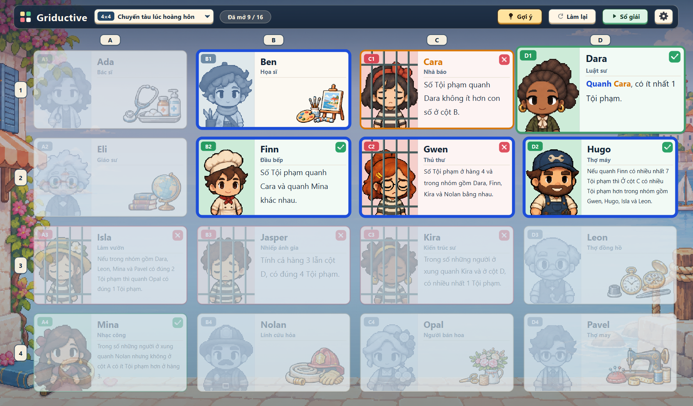

# Griductive Solver: Suy luận Không Đoán Mò bằng Mã hóa CNF và Bộ giải DPLL

**BÁO CÁO ĐỒ ÁN THỰC HÀNH 2**

Đại học Quốc gia TP.HCM · Trường Đại học Khoa học Tự nhiên · Khoa Công nghệ Thông tin · Bộ môn Công nghệ Tri thức

**CSC14003 – Nhập môn Trí tuệ Nhân tạo** · Lớp học phần **24TN**  
Thành phố Hồ Chí Minh, ngày 27 tháng 11 năm 2026

Phan Ngọc Thức (24120228), Nguyễn Lê Minh Quân (24120219), Tống Phúc Thiện (24120141), Bùi Phương Nam (24120502) và Phan Gia Phúc (24120503).

## 1. Kế hoạch dự án, phân công và kiến trúc hệ thống

Một lượt chơi chỉ thành công khi nhóm chứng minh được trạng thái của một nhân vật từ những lá bài đã mở. Nhóm triển khai cùng một quy tắc cho người chơi, chức năng gợi ý và chế độ tự giải, theo yêu cầu của đồ án CSC14003 [1]. Cách lật thẻ và chọn lời khai tham khảo Griductive và Clues by Sam [2], [3].

### Kế hoạch và mức hoàn thành

Nhóm thống nhất giao diện dữ liệu giữa bàn chơi và tác tử trước khi phát triển song song ba mô-đun lõi. Sau khi tích hợp bộ mã hóa, bộ giải SAT và cơ chế mở thẻ, nhóm nối hai giao diện, chạy kiểm thử, đo sáu màn chơi rồi đối chiếu nhật ký để lập báo cáo và dựng video.

**Phân công theo mô-đun và tỷ lệ hoàn thành**

| Thành viên | MSSV | Phần việc phụ trách | Hoàn thành |
| --- | --- | --- | --- |
| Phan Ngọc Thức | 24120228 | Kiến trúc chung, Desktop Cozy Harbor, Web Dash, thực nghiệm, báo cáo và video. | 100% |
| Nguyễn Lê Minh Quân | 24120219 | Tổ chức thực nghiệm, so sánh hai chiến lược chọn biến, phân tích số liệu, báo cáo và video. | 100% |
| Tống Phúc Thiện | 24120141 | Phân giải vùng và phép tập hợp, đánh giá ngữ nghĩa, điều phối GameEngine và kiểm tra nghiệm duy nhất. | 100% |
| Bùi Phương Nam | 24120502 | Bộ giải DPLL với hai chiến lược chọn biến và suy luận phản chứng của LogicAgent. | 100% |
| Phan Gia Phúc | 24120503 | Cổng Tseitin, bộ đếm ngưỡng bằng quy hoạch động và mã hóa tất cả dạng manh mối sang CNF. | 100% |

Tỷ lệ trong bảng lấy từ hồ sơ nhóm `docs/team.json`. Điểm cá nhân bằng điểm nhóm nhân với tỷ lệ hoàn thành của thành viên. Theo ví dụ trong đề, điểm nhóm 9,0 và tỷ lệ 90% cho điểm cá nhân 8,1. Với tỷ lệ 100%, mỗi thành viên nhận điểm nhóm.

> **Video trình diễn trên Google Drive**  
> Liên kết xem: Chờ nhóm cung cấp.

### Quyền truy cập dữ liệu và luồng xử lý

**Trách nhiệm và dữ liệu qua từng thành phần**

| Thành phần | Dữ liệu và trách nhiệm |
| --- | --- |
| `GameEngine` | Giữ `PrivatePuzzle`, nghiệm đầy đủ, lời khai chưa mở và nhật ký các bước đã chấp nhận. Tạo ảnh chụp công khai để kiểm tra từng yêu cầu. |
| `PublicState` | Đối tượng bất biến chứa thông tin bàn, nhân vật, các trạng thái đã biết và lời khai đã mở. Các cấu trúc lồng cũng được đóng băng. |
| `LogicAgent` | Chỉ nhận ảnh chụp công khai và bộ xử lý luật. Dựng KB, hỏi SAT, chứng minh hoặc từ chối phán quyết. |
| Desktop và Web | PySide6 và Plotly Dash gọi cùng lõi Python. Mỗi phiên quản lý tiến độ riêng. Giao diện vẽ lại bàn từ dữ liệu công khai. |

Khi người chơi gửi một phán quyết, engine chuyển trạng thái công khai hiện tại cho một tác tử kiểm chứng độc lập. Chỉ sau khi có chứng minh, engine mới đối chiếu nghiệm riêng để phát hiện dữ liệu bất nhất, ghi trạng thái, mở lời khai và thêm một bước vào nhật ký. Một đề nghị bị bác không làm lộ nội dung thẻ.

Trên Desktop, `EngineWorker` chạy hàng đợi tuần tự trong `QThread` và gửi kết quả về cửa sổ qua signal của Qt [4]. Mỗi tác vụ chạy trên `GameEngine.fork()`. Bản sao dùng chung câu đố bất biến nhưng có trạng thái, lời khai đã mở và danh sách nhật ký riêng. Khi đổi màn hoặc hủy yêu cầu, cờ hủy được kiểm tra cả trong DPLL lẫn trước khi ghi phán quyết. `SolverCancelled` kết thúc phép tìm kiếm cũ. Mã phiên và mã yêu cầu giúp cửa sổ bỏ qua kết quả đến muộn.

Web tái dựng phiên theo lịch sử phán quyết và dùng cùng phép kiểm chứng. Vì vậy, lời giải có thể đối chiếu giữa giao diện, bộ thực nghiệm dòng lệnh và bộ kiểm thử từ cùng một tập đầu vào.

## 2. Mô hình hóa bài toán và ngôn ngữ manh mối

### Biến chính và tri thức công khai

Trên bàn $N\times N$, với $N\in\{3,4,5\}$, cột A có chỉ số $c=1$ và hàng trên cùng có $r=1$. Biến $C_i$ mang giá trị True (Criminal, tội phạm) hoặc False (Innocent, vô tội). Chỉ số $i=(r-1)N+c$ chạy từ 1 đến $N^2$. Chẳng hạn A3 trên bàn $3\times3$ là biến số 7. Tên và nghề giúp nhận diện nhân vật. Lời khai đã mở luôn đúng, kể cả khi chủ thẻ là tội phạm.

Gọi $L_t$ là tập lời khai đã mở và $S_t$ là tập ô đã biết ở bước $t$. Với mỗi ô trong $S_t$, đặt $\ell_i=C_i$ nếu ô là tội phạm và $\ell_i=\neg C_i$ nếu ô vô tội. Cơ sở tri thức (KB) có dạng

$$
KB_t=\bigwedge_{q\in L_t}\operatorname{CNF}(q)\ \land\ \bigwedge_{i\in S_t}(\ell_i).
$$

Tác tử duyệt các ô chưa mở theo thứ tự hàng, chọn ô đầu tiên có phán quyết bắt buộc. Khi engine chấp nhận, trạng thái và lời khai của ô cùng gia nhập KB ở bước kế tiếp. Vòng lặp dừng khi mở hết bàn, hết phán quyết chứng minh được hoặc gặp mâu thuẫn.

**Sáu kiểu manh mối cơ sở**

| Kiểu | Nội dung trên một phép gán |
| --- | --- |
| `FACT` | Một người có trạng thái chỉ định, biểu diễn bằng $C_i$ hoặc $\neg C_i$. |
| `SAME` | Hai người cùng trạng thái, $C_i\leftrightarrow C_j$. |
| `DIFFERENT` | Hai người khác trạng thái, $C_i\oplus C_j$. |
| `EXACTLY` | Số tội phạm trong vùng $R$ đúng bằng $k$. |
| `AT_LEAST` | Có ít nhất $k$ tội phạm trong $R$. |
| `AT_MOST` | Có nhiều nhất $k$ tội phạm trong $R$. |

Các manh mối đếm yêu cầu $k$ nguyên và $0\le k\le |R|$. Câu “không có tội phạm” tương ứng với $\operatorname{EXACTLY}(0,R)$. Với vùng rỗng, số tội phạm bằng 0.

### Vùng, so sánh và điều kiện lồng

**Vùng cơ sở và các phép hợp thành**

| Kiểu vùng | Tập ô được chọn |
| --- | --- |
| `ROW`, `COLUMN` | Toàn bộ một hàng hoặc một cột hợp lệ. |
| `NEIGHBORS` | Các ô kề theo tám hướng, bỏ ô mốc. Một ô góc có ba láng giềng, ô biên còn lại có năm và ô ở trong có tám. |
| `EXPLICIT` | Các ô phân biệt được liệt kê theo định danh. Danh sách có thể rỗng. |
| `CORNERS` | Bốn ô góc của bàn. |
| `UNION`, `INTERSECTION` | Hợp hoặc giao của hai vùng con. Mỗi ô chỉ xuất hiện một lần trong vùng kết quả. |
| `DIFFERENCE` | Các ô thuộc vùng trái và không thuộc vùng phải. Thứ tự hai toán hạng quyết định kết quả. |

`COMPARISON` so sánh số tội phạm trong hai vùng bằng một trong sáu quan hệ $=,\ne,<,\le,>,\ge$. Nếu hai vùng giao nhau, cùng một biến ô tham gia vào cả hai tổng. `CONDITIONAL` nhận hai manh mối bất kỳ làm tiền đề và kết luận. Hai vế có thể tiếp tục chứa điều kiện lồng. Mệnh đề kéo theo sai đúng trong trường hợp tiền đề đúng và kết luận sai.

Trong màn `case-3x3-01`, lời khai công khai B1 đòi hỏi ít nhất ba tội phạm trong tập láng giềng của A2 sau khi trừ hàng 2. Trên bàn này, vùng còn lại là $\{\mathrm{A1},\mathrm{B1},\mathrm{A3},\mathrm{B3}\}$. Cách phân giải vùng xác định chính xác bốn biến đi vào bộ đếm và bốn ô giao diện cần tô sáng.

Bộ đăng ký ánh xạ tên kiểu JSON sang lớp xử lý. `@register_region` gắn kiểu vùng với hàm phân giải, còn `@register_clue` gắn kiểu manh mối với kiểm tra tham số, biểu thức logic và hàm đánh giá. Gốc có độ sâu 0. Bộ kiểm tra từ chối cây vùng hoặc cây điều kiện khi độ sâu vượt 12. Nhờ giao diện chung, thêm luật mới chỉ cần đăng ký lớp xử lý và kiểm thử ngữ nghĩa của luật đó.

## 3. Biểu diễn logic tự động và chuyển đổi sang CNF

### Từ quan hệ hai ngôi đến mệnh đề

Mã hóa SAME bắt đầu từ hai chiều kéo theo. Mỗi chiều loại một khả năng trái với điều kiện “cùng trạng thái”. Thay phép kéo theo bằng phép tuyển cho hai mệnh đề sau.

$$
\begin{aligned}
\operatorname{SAME}(A,B)&\equiv C_A\leftrightarrow C_B\\
&\equiv(C_A\to C_B)\land(C_B\to C_A)\\
&\equiv(\neg C_A\lor C_B)\land(C_A\lor\neg C_B).
\end{aligned}
$$

Với DIFFERENT, ít nhất một biến phải đúng và ít nhất một biến phải sai. Hai mệnh đề này lần lượt loại trường hợp cả hai vô tội và cả hai là tội phạm.

$$
\begin{aligned}
\operatorname{DIFFERENT}(A,B)&\equiv C_A\oplus C_B\\
&\equiv (C_A\lor C_B)\land\neg(C_A\land C_B)\\
&\equiv (C_A\lor C_B)\land(\neg C_A\lor\neg C_B).
\end{aligned}
$$

### Đếm trực tiếp trên ba ô

Viết $A,B,C$ cho ba biến của vùng. Để có ít nhất hai tội phạm, mọi cặp ô đều phải chứa một tội phạm. Để có nhiều nhất hai, bộ ba phải chứa một người vô tội. Lấy hội của hai điều kiện thu được

$$
\begin{aligned}
\operatorname{EXACTLY}(2,\{A,B,C\})\equiv{}&
(A\lor B)\land(A\lor C)\land(B\lor C)\\
&{}\land(\neg A\lor\neg B\lor\neg C).
\end{aligned}
$$

Tổng quát, mỗi tập con cỡ $n-k+1$ cho một mệnh đề dương và mỗi tập con cỡ $k+1$ cho một mệnh đề âm. Vì $\binom{n}{n-k+1}=\binom{n}{k-1}$, số mệnh đề là $\binom{n}{k-1}+\binom{n}{k+1}$, quy ước hệ số bằng 0 ngoài miền. Với $n=25,\ k=12$, riêng một manh mối đã cần $9\,657\,700$ mệnh đề.

### Bộ đếm ngưỡng unary và cổng Tseitin

Gọi $T(i,k)$ là mệnh đề “ít nhất $k$ trong $i$ ô đầu là tội phạm”. Ngưỡng 0 luôn đúng, còn $k>i$ luôn sai. Khi thêm ô thứ $i$, ngưỡng $k$ hoặc đã đạt trước đó, hoặc vừa đạt nhờ ô này là tội phạm và $i-1$ ô đầu đã đủ $k-1$. Do đó

$$
T(i,k)\leftrightarrow T(i-1,k)\lor\bigl(C_i\land T(i-1,k-1)\bigr).
$$

Mỗi trạng thái của bảng tam giác cần nhiều nhất một cổng AND và một cổng OR hai đầu vào. Tổng số cổng và mệnh đề cho một vùng là $O(n^2)$. `Encoder` tái sử dụng bộ ngưỡng theo bộ ô đã sắp thứ tự và cổng theo loại cùng các literal đầu vào. Bộ cấp biến chung bắt đầu tại $N^2+1$. Hằng, literal trùng và hai literal đối nhau được rút gọn trước khi cấp biến.

Theo phép biến đổi Tseitin [5], mỗi đầu ra phụ $z$ được ràng buộc theo cả hai chiều. Ví dụ với $z\leftrightarrow(a\land b)$ và $w\leftrightarrow(a\lor b)$, ta có

$$
\begin{aligned}
&(\neg z\lor a)\land(\neg z\lor b)\land(z\lor\neg a\lor\neg b),\\
&(w\lor\neg a)\land(w\lor\neg b)\land(\neg w\lor a\lor b).
\end{aligned}
$$

Đặt $T_R(k)=T(|R|,k)$. Ba ràng buộc “ít nhất”, “nhiều nhất” và “đúng bằng” lần lượt nhận literal hoặc biểu thức $T_R(k)$, $\neg T_R(k+1)$ và $T_R(k)\land\neg T_R(k+1)$. Bộ mã hóa buộc đầu ra của mỗi manh mối công khai bằng một mệnh đề đơn. Đầu ra hằng sai sinh mệnh đề rỗng, đầu ra hằng đúng không cần thêm mệnh đề.

### Mã hóa các manh mối mở rộng

Số tội phạm trong $R_1$ lớn hơn hoặc bằng số trong $R_2$ khi mọi ngưỡng đạt ở $R_2$ đều đạt ở $R_1$. Quan hệ này tương đương

$$
\bigwedge_{k=1}^{|R_2|}\bigl(\neg T_{R_2}(k)\lor T_{R_1}(k)\bigr).
$$

Đổi hai vùng cho quan hệ $\le$, lấy hội hai chiều cho dấu bằng, rồi phủ định quan hệ tương ứng cho $\ne$, $<$ hoặc $>$. Với điều kiện lồng, bộ mã hóa xây hai đầu ra $r_{\mathrm{if}},r_{\mathrm{then}}$ rồi tạo cổng cho $\neg r_{\mathrm{if}}\lor r_{\mathrm{then}}$. Độc lập với CNF, `evaluate()` tính giá trị luật trực tiếp trên phép gán hoàn chỉnh bằng so sánh Boolean, đếm ô hoặc đánh giá đệ quy hai vế. Các kiểm thử đối chiếu hai cách tính.

## 4. Thuật toán DPLL, suy luận phản chứng và kiểm tra nghiệm duy nhất

### Tìm mô hình bằng DPLL

Bộ giải tự cài đặt theo DPLL [6]. Trước khi tìm kiếm, chương trình loại literal lặp trong mỗi mệnh đề, bỏ mệnh đề hằng đúng và thêm các giả định dưới dạng mệnh đề đơn. Mỗi lời gọi đệ quy chỉ kế thừa phép gán trên nhánh hiện tại.

**DPLL-Solve với hai chiến lược chọn biến**

```text
Đầu vào: CNF F, tổng số biến m, phép gán A (ban đầu rỗng), chiến lược h
Lặp
  Kiểm tra cờ hủy và hạn thời gian. Nếu có mệnh đề rỗng, trả UNSAT.
  Lấy tập U các literal trong mệnh đề đơn. Nếu U=∅, thoát vòng lặp.
  Với mỗi ℓ∈ U
    Nếu ℓ xung đột với A, trả UNSAT. Nếu mới, gán và tăng số lan truyền.
  Rút gọn F theo A: bỏ mệnh đề đúng và xóa literal sai.
Nếu F rỗng
  Điền False cho mọi biến chưa gán trong 1,…,m. Trả SAT và mô hình.
Đếm số lần xuất hiện của mỗi biến còn trong F, gộp cả hai dấu.
Với ordered, lấy ID nhỏ nhất. Với frequency, lấy tần suất cao nhất, hòa chọn ID nhỏ nhất. Gọi biến được chọn là v.
Tăng số quyết định một lần.
Với b theo thứ tự True, False
  Sao chép A, gán v=b, rút gọn F và gọi DPLL-Solve đệ quy.
  Nếu nhánh trả SAT, trả mô hình. Nếu nhánh thất bại, tăng số quay lui.
Trả UNSAT.
```

Hai mệnh đề đơn đối nhau tạo xung đột ngay trong một đợt lan truyền. Khi tất cả mệnh đề đã đúng, điền False cho các biến tự do vẫn bảo toàn nghiệm. Bộ đếm quyết định ghi số nút phân nhánh, còn số quay lui ghi từng nhánh con thất bại. Thời gian được đo riêng cho từng truy vấn SAT.

### Chứng minh một phán quyết bằng phản chứng

Trước hết phải xác nhận $KB$ khả thỏa. Khi đó, $KB\land\neg C_i$ vô nghiệm chứng minh ô $i$ là tội phạm. Nếu $KB\land C_i$ vô nghiệm, ô đó vô tội. Nếu cả hai khả thỏa, mỗi mô hình làm nhân chứng cho một khả năng và ô còn `UNKNOWN`.

**Phân loại có lưu nhân chứng và kiểm chứng đề nghị**

```text
Đầu vào: Ảnh chụp công khai, chế độ phân loại hoặc kiểm chứng literal đề nghị p
Dựng KB, giải một lần. Nếu UNSAT, trả INCONSISTENT.
Nếu chế độ verify
  Nếu KB ∧ ¬p là UNSAT, trả ACCEPTED.
  Nếu KB∧p là UNSAT, trả CONTRADICTED.
  Trả NOT_PROVABLE.
Từ mô hình cơ sở, ghi nhận dấu đã thấy của từng biến chính.
Với mỗi ô chưa mở theo thứ tự hàng
  Nếu đã thấy cả hai dấu của C_i, xuất UNKNOWN và xét ô tiếp theo.
  Gọi ℓ là dấu chưa thấy. Giải KB ∧ ℓ.
  Nếu kết quả là UNSAT
    Xuất CRIMINAL nếu ℓ=¬C_i, ngược lại xuất INNOCENT.
    
  Ngược lại
    Ghi dấu của mọi biến chính trong mô hình mới, xuất UNKNOWN.
```

Trong `LogicAgent._verdicts`, mô hình cơ sở cung cấp ít nhất một dấu cho mọi ô. Do đó sau truy vấn chung, mỗi ô cần tối đa một truy vấn bổ sung, đôi khi bằng không. Bộ nhớ nhân chứng chỉ sống trong lần duyệt KB hiện tại. Hàm `verify` kiểm tra độc lập đề nghị gửi lên nên có thể cần cả hai truy vấn giả định.

Ví dụ, với $KB=(A\lor B)\land(\neg A\lor B)$, giả sử $\neg B$ tạo hai mệnh đề đơn $A$ và $\neg A$. Do đó $B$ là tội phạm. Cả hai giá trị của $A$ đều đi cùng $B$ đúng, nên tác tử để thẻ $A$ úp. Nếu ngay từ đầu $KB$ chứa cả $A$ và $\neg A$, kết quả là `INCONSISTENT`.

### Vòng suy luận, nhật ký và tính duy nhất

`next_verdict` dừng tại ô bắt buộc đầu tiên. `hint` trả lại gợi ý, còn `step` gửi phán quyết cho engine kiểm chứng. Khi chấp nhận, engine ghi số bước, ô, phán quyết, ID các lời khai đang hoạt động, truy vấn SAT và lời khai mới. Lần suy luận tiếp theo dùng ảnh chụp mới. Khi tất cả ô chưa mở đều còn hai khả năng, vòng tự giải dừng ở UNKNOWN và giữ nguyên bàn.

Nhật ký `case-3x3-01` với `ordered` cho thấy tại bước 1 chỉ có lời khai B1 và C1. KB có 9 biến chính, 39 biến phụ và 123 mệnh đề. Truy vấn cơ sở SAT, còn giả định $-7$ cho UNSAT sau 46 phép lan truyền và không cần phân nhánh. Engine chấp nhận A3 là tội phạm rồi mới mở lời khai A3. Bước 2 đã có ba lời khai để xét A1.

Để kiểm tra bộ dữ liệu ngoại tuyến, `check_uniqueness` dựng $F$ từ toàn bộ lời khai. Nếu $F$ vô nghiệm, trả `INCONSISTENT`. Nếu có mô hình $M$, thêm mệnh đề chặn trên $P$, tập ID lấy từ `kb.primary.values()`: 

$$
B_M=\bigvee_{v\in P}\begin{cases}\neg v,&M(v)=\mathrm{True},\\v,&M(v)=\mathrm{False}.\end{cases}
$$

Mọi nghiệm của $F\land B_M$ phải khác $M$ ở ít nhất một ô. Truy vấn thứ hai trả UNSAT xác nhận `UNIQUE`, còn SAT xác nhận `MULTIPLE`. Việc chỉ chặn biến chính bảo đảm khác biệt ở biến phụ không bị tính thành lời giải thứ hai. Tính duy nhất của toàn bộ lời khai và khả năng đi tiếp từ một trạng thái công khai là hai phép kiểm tra riêng.

### Kiểm thử tự động

Lệnh `python -B -m unittest discover -s tests -v` chạy đạt 87/87 kiểm thử trong 13 mô-đun. Các kiểm thử lõi đối chiếu hàm đánh giá trực tiếp với CNF trên phép gán, kiểm tra giả định, quay lui, điều kiện lồng, vùng rỗng và đăng ký luật mới. Nhóm kiểm thử phiên chơi bao phủ tính duy nhất, từ chối phán quyết, hủy công việc nền và tái dựng lịch sử Web. Các mô-đun giao diện kiểm tra nhật ký, bản địa hóa, tương tác và sự ổn định của ảnh động.

## 5. Thực nghiệm và đánh giá Ordered, Frequency

Hai cấu hình tự giải cùng sáu tệp câu đố theo thứ tự cố định, mỗi cấu hình chạy một lượt cho mỗi màn. Môi trường đo là Windows 11, Python 3.14.6 và CPU Intel Core i5-12450HX. Cột N là số hàng, cũng là số cột. Hai bảng ghép theo mã màn và chiến lược chọn biến.

**Trạng thái kết thúc, kích thước KB cuối và số bước mở thẻ**

| Màn | Chiến lược | N | Trạng thái | Nghiệm | Biến chính | Biến phụ | Mệnh đề | Bước |
| --- | --- | --- | --- | --- | --- | --- | --- | --- |
| case-3x3-01 | ordered | 3 | SOLVED | UNIQUE | 9 | 156 | 491 | 7 |
| case-3x3-01 | frequency | 3 | SOLVED | UNIQUE | 9 | 156 | 491 | 7 |
| case-3x3-02 | ordered | 3 | SOLVED | UNIQUE | 9 | 144 | 455 | 7 |
| case-3x3-02 | frequency | 3 | SOLVED | UNIQUE | 9 | 144 | 455 | 7 |
| case-4x4-01 | ordered | 4 | SOLVED | UNIQUE | 16 | 364 | 1138 | 13 |
| case-4x4-01 | frequency | 4 | SOLVED | UNIQUE | 16 | 364 | 1138 | 13 |
| case-4x4-02 | ordered | 4 | SOLVED | UNIQUE | 16 | 273 | 862 | 13 |
| case-4x4-02 | frequency | 4 | SOLVED | UNIQUE | 16 | 273 | 862 | 13 |
| case-5x5-01 | ordered | 5 | SOLVED | UNIQUE | 25 | 668 | 2068 | 22 |
| case-5x5-01 | frequency | 5 | SOLVED | UNIQUE | 25 | 668 | 2068 | 22 |
| case-5x5-02 | ordered | 5 | SOLVED | UNIQUE | 25 | 654 | 2045 | 22 |
| case-5x5-02 | frequency | 5 | SOLVED | UNIQUE | 25 | 654 | 2045 | 22 |

**Chi phí của vòng suy luận và kiểm chứng theo từng lượt chạy**

| Màn | Chiến lược | Gọi SAT | Quyết định | Lan truyền | Quay lui | Thời gian (s) |
| --- | --- | --- | --- | --- | --- | --- |
| case-3x3-01 | ordered | 34 | 48 | 2944 | 4 | 0.046906800009310246 |
| case-3x3-01 | frequency | 33 | 40 | 2942 | 4 | 0.0597596000880003 |
| case-3x3-02 | ordered | 30 | 34 | 2802 | 15 | 0.07075270009227097 |
| case-3x3-02 | frequency | 30 | 27 | 2693 | 9 | 0.051106599974446 |
| case-4x4-01 | ordered | 84 | 518 | 29666 | 444 | 1.0145338999573141 |
| case-4x4-01 | frequency | 85 | 287 | 18887 | 8 | 0.5042751999571919 |
| case-4x4-02 | ordered | 93 | 168 | 12568 | 7 | 1.1509451000019908 |
| case-4x4-02 | frequency | 91 | 158 | 12567 | 16 | 1.0898051999974996 |
| case-5x5-01 | ordered | 162 | 193 | 43608 | 18 | 3.482975700055249 |
| case-5x5-01 | frequency | 164 | 247 | 44288 | 45 | 3.591464600060135 |
| case-5x5-02 | ordered | 182 | 752 | 55976 | 113 | 6.432317500002682 |
| case-5x5-02 | frequency | 182 | 647 | 53655 | 37 | 5.540036999969743 |

Tổng truy vấn gồm cả tác tử đề xuất và engine kiểm chứng. Thời gian bao gồm dựng KB và thực hiện vòng mở thẻ. Các phép giải ngoại tuyến để kiểm tra nghiệm duy nhất diễn ra sau khi dừng đồng hồ và được loại khỏi cả bốn bộ đếm.

### Chi phí tìm kiếm trên cùng một câu đố


*Quyết định và quay lui của DPLL. Hai trục ngang có thang đo riêng.*

Trên màn 4×4-01, đổi sang frequency giảm từ 518 xuống 287 quyết định và từ 444 xuống 8 lần quay lui, dù số lần gọi SAT tăng từ 84 lên 85. Trong lần giải KB ban đầu, ordered chọn biến số 1, xuất hiện 4 lần trong công thức đã rút gọn. Frequency chọn biến số 11, xuất hiện 24 lần. Đây là biến ô trên bàn 4×4. Gán biến liên quan đến nhiều mệnh đề có thể buộc thêm các ngưỡng đếm và làm lộ xung đột sớm.

Các biến phụ Tseitin cũng tham gia chọn nhánh. Một đầu ra ngưỡng dùng chung ở nhiều cổng có thể có tần suất cao và ảnh hưởng nhiều ràng buộc cùng lúc. Tuy nhiên, số liệu tổng không xác định cổng nào gây ra từng lần cắt nhánh. Trên màn 5×5-02, với cùng 182 truy vấn, frequency giảm từ 752 xuống 647 quyết định và từ 113 xuống 37 lần quay lui, kéo thời gian chạy từ khoảng 6,432 giây xuống 5,540 giây.

Màn 5×5-01 cho kết quả ngược lại. Ordered cần 193 quyết định và 18 lần quay lui, frequency cần 247 và 45. Ngay ở KB đầu tiên, ordered chọn biến số 4 và tìm được mô hình sau hai quyết định. Frequency ưu tiên biến số 18, cần ba quyết định và một lần quay lui. Vì cả hai cùng thử True trước, chọn biến xuất hiện nhiều vẫn có thể đưa bộ giải vào một nhánh thất bại.

### Thời gian chạy, quy mô CNF và giới hạn



*Thời gian toàn phiên và số mệnh đề trong KB cuối. Hai cấu hình sinh cùng một CNF cuối cho từng màn.*

Cỡ bàn không quyết định toàn bộ chi phí. Hai màn 5×5 cùng cần 22 bước và có số mệnh đề cuối gần nhau (2 068 và 2 045), nhưng màn thứ hai cần nhiều quyết định hơn ở cả hai chiến lược. Thời gian phản ánh chuỗi KB từ lúc mở màn đến khi hoàn tất: ở 4×4-01 giảm từ 1,015 xuống 0,504 giây, còn ở 5×5-01 tăng nhẹ từ 3,483 lên 3,591 giây với frequency. Mỗi lượt chịu ảnh hưởng của tải hệ thống, chi phí xử lý mệnh đề và thứ tự tìm mô hình.

Khi mô hình trả về khác nhau, các dấu mà tác tử đã có nhân chứng cũng có thể khác. Điều này giải thích vì sao số lần gọi SAT đôi khi thay đổi dù hai cấu hình mở cùng số thẻ. Ở màn 4×4-02, frequency dùng ít quyết định hơn (158 so với 168) nhưng quay lui nhiều hơn (16 so với 7). Một chỉ số đơn lẻ không mô tả đủ chi phí của một phiên.

Cả 12 lượt đều trả SOLVED, và phép kiểm tra ngoại tuyến cho UNIQUE trên cả sáu màn. UNKNOWN có thể xuất hiện khi tri thức công khai cho phép hai giá trị ở mọi ô còn lại. INCONSISTENT xuất hiện khi chính KB vô nghiệm. Bộ đo giữ các trạng thái dừng và TIMEOUT trong kết quả. Hạn mặc định cho một màn là 30 giây, được kiểm tra giữa các bước, kèm hạn riêng cho từng truy vấn SAT.

DPLL hiện quét lại danh sách mệnh đề khi lan truyền và khi rút gọn nhánh. Kỹ thuật theo dõi hai literal trong mỗi mệnh đề (two-watched literals) có thể giảm số mệnh đề cần xét. Bộ giải cũng chưa học mệnh đề từ xung đột hay quay lui không tuần tự như CDCL. Trên sáu màn với một lần đo mỗi cấu hình, có thể so sánh hành vi tìm kiếm cụ thể, nhưng chưa thể ước lượng phân bố thời gian hay chọn một chiến lược tối ưu cho mọi màn.

## 6. Giao diện người dùng Desktop Cozy Harbor và Web Dash

### Chọn màn và chơi thủ công

Cozy Harbor hiển thị tọa độ, tên, nghề nghiệp, trạng thái đã chứng minh và lời khai trên thẻ đang mở. Từ menu hồ sơ, người chơi chọn một trong sáu màn hoặc mở tệp JSON. Chọn một thẻ úp để gửi phán quyết tội phạm hoặc vô tội. Khi chứng minh thành công, thẻ lật để lộ lời khai tiếp theo.



*Menu hồ sơ trên bàn 3×3. Các màn được nhóm theo kích thước bàn.*

Gợi ý xác định nhân vật có thể chứng minh tiếp theo từ cùng ảnh chụp công khai. Nút “Xem nhân vật” dẫn người chơi đến thẻ cần xét. Thao tác xem gợi ý giữ nguyên số thẻ đã mở.


*Hộp gợi ý chỉ đến Gwen, thủ thư ở A3, khi các lời khai đã đủ để xác định trạng thái của cô.*

### Đọc lời khai và theo dõi quá trình giải



*Bàn 4×4 khi chọn lời khai. Viền màu xác định các ô thuộc vùng tham chiếu, còn các ô ngoài vùng được làm mờ.*

Với lời khai nhiều vùng, màu của từng cụm từ khớp với đường viền trên bàn. Chọn hoặc ghim một vùng giúp đọc đúng toán hạng của phép so sánh. “Tự giải” lần lượt thực hiện các bước đã chứng minh. “Làm lại” khởi tạo lại màn từ những thẻ mở ban đầu.


*Bàn 5×5 bên cạnh sổ tay suy luận. Mỗi mục ghi ô vừa được xác định và có nút xem chi tiết.*

### Phiên chơi Web Dash

Giao diện Web dùng callback của Plotly Dash [7] để nhận thao tác, dựng lại bàn và trả phần hiển thị công khai. Với màn có sẵn, `dcc.Store` ở chế độ `session` lưu mã màn, lịch sử nước đi và lựa chọn hiển thị. Đáp án và manh mối chưa mở nằm ở máy chủ. Nếu người chơi tự nạp tệp JSON, dữ liệu phiên còn giữ bản tệp do chính họ cung cấp để tái dựng màn.

Mỗi callback tạo một GameEngine cho phiên, kiểm tra kiểu dữ liệu và giới hạn số nước trong lịch sử theo số ô. Máy chủ phát lại từng đề nghị qua `submit`. Một nước thiếu chứng minh hoặc bị sửa sẽ khiến lịch sử bị từ chối. Chỉ sau khi tái dựng thành công, callback mới xử lý thao tác mới. Các phiên có thể đọc cùng bộ câu đố bất biến nhưng không chia sẻ tiến độ chơi.

Ví dụ, tự thêm A3 vào lịch sử phía trình duyệt chỉ có hiệu lực nếu máy chủ chứng minh được phán quyết tại đúng thời điểm đó. Đoán đúng đáp án ẩn vẫn chưa đủ để mở lá bài. Bộ kiểm thử Web gửi yêu cầu callback thật, kiểm tra từ chối lịch sử giả và xác nhận dữ liệu trả về cho màn tích hợp sẵn không chứa nghiệm ẩn.

Tệp tùy chỉnh được kiểm tra mã hóa, giới hạn 128 000 byte sau giải mã và được đọc qua một tệp tạm trước khi đưa vào bộ nạp câu đố chung. Cả Desktop và Web đều dùng chung phép chứng minh và điều kiện chấp nhận. Desktop giữ phiên trên worker, còn Web trả chi phí phát lại lịch sử để có thể xử lý yêu cầu kế tiếp trong tiến trình mới.

## Tài liệu tham khảo

1. Khoa Công nghệ Thông tin, Trường Đại học Khoa học Tự nhiên, ĐHQG-HCM. Đề đồ án học phần, mục 4.1–4.7, trang 5–8. CSC14003: Introduction to Artificial Intelligence. Project 2: Griductive Solver.
2. Knotwise Games. [Griductive: How to Play](https://knotwise.games/games/griductive/how-to-play).
3. Clues by Sam. [Clues by Sam](https://cluesbysam.com/).
4. The Qt Company. [Qt for Python 6: QThread](https://doc.qt.io/qtforpython-6/PySide6/QtCore/QThread.html).
5. G. S. Tseitin. Automation of Reasoning, tập 2, Springer, 1983, tr. 466–483. [On the Complexity of Derivation in Propositional Calculus](https://doi.org/10.1007/978-3-642-81955-1_28).
6. Martin Davis, George Logemann và Donald Loveland. Communications of the ACM, 5(7), 1962, tr. 394–397. [A Machine Program for Theorem-Proving](https://doi.org/10.1145/368273.368557).
7. Plotly. [Dash Documentation: Basic Callbacks](https://dash.plotly.com/basic-callbacks).
8. Stable Diffusion v1.5. [Stable Diffusion Inpainting: Model Card](https://huggingface.co/stable-diffusion-v1-5/stable-diffusion-inpainting).
9. gamedev-skills. [Awesome Gamedev Agent Skills](https://github.com/gamedev-skills/awesome-gamedev-agent-skills).
10. safina57. [Clues by Sam Solver](https://github.com/safina57/clues-by-sam-solver).
11. TranTai35. [Griductive Solver](https://github.com/TranTai35/griductive-solver).
12. WadeWartz. [Griductive-Solver](https://github.com/WadeWartz/Griductive-Solver).

## A. Phụ lục về AI tạo sinh và cách kiểm chứng

### Lập trình, tích hợp và soạn báo cáo

Nhóm dùng Codex hỗ trợ phân tích yêu cầu, triển khai mô-đun, viết kiểm thử và tái chạy thực nghiệm. Antigravity hỗ trợ chuẩn bị yêu cầu theo đầu việc và tổ chức các lượt rà soát giao diện, báo cáo và video. Khi giao việc cho công cụ, nhóm chỉ rõ đầu vào công khai, kiểu kết quả mong đợi và trường hợp phải từ chối. Các ví dụ dưới đây diễn giải nội dung yêu cầu, trừ chỗ ghi rõ là trích nguyên văn.

Ví dụ yêu cầu về suy luận là “Chỉ truyền PublicState cho tác tử. Với mỗi phán quyết, thử giả định phủ định và giải thích khi nào trả UNKNOWN hoặc INCONSISTENT.” Yêu cầu về luật mở rộng xác định cả sáu toán tử so sánh và cho phép một điều kiện nhận hai cây manh mối bất kỳ. Nhóm kiểm chứng bằng phản ví dụ, phép gán hoàn chỉnh, kiểm thử hồi quy và nhật ký ngay trước khi mở lời khai. Kết quả thực nghiệm trong báo cáo lấy từ lần chạy chương trình.

### Đồ họa, sửa ảnh có mặt nạ và nghiệm thu

Nhật ký `docs/AI-PROMPTS.md` lưu yêu cầu tạo atlas, ảnh tham chiếu, lỗi cần sửa và thứ tự khung. Một trích đoạn cho Ada là “keep face center, eye line, head scale, hair silhouette and shoulders in exactly same position across all nine frames”. Việc khóa vị trí khuôn mặt và thứ tự biểu cảm giúp thẻ chuyển khung mà nhân vật không bị nhảy vị trí.

Với ImageGen, nhóm chỉ định số hàng/cột, nền RGBA, phần trang phục thay đổi, giới hạn mỗi ô và vùng cần để trống. Khi có quầng nền hoặc áo sai, yêu cầu sửa tập trung vào đúng lỗi và giữ nguyên phần còn lại. Với chớp mắt, Stable Diffusion 1.5 Inpainting chỉ tái tạo vùng có mặt nạ quanh mắt, giữ pixel ngoài mặt nạ và kênh alpha gốc [8]. Khi thay bảy khung của Finn, nhóm đối chiếu 24 hàng nhân vật khác theo byte, kiểm tra mép alpha và chiều cao tư thế. Các ảnh giao diện trong mục 6 là ảnh chụp chương trình.

### Thuyết minh và nguồn đối chiếu

ElevenLabs TTS chuyển kịch bản tiếng Việt thành từng đoạn thoại để khớp với thao tác trên bàn. Quy trình đo thời lượng từng tệp âm thanh, ghép đoạn vào trục hình 24 khung/giây và dùng các khoảng ngắt giọng để căn phụ đề. Các cảnh chọn màn, gợi ý, phán quyết bị từ chối và tự giải được kiểm tra theo trạng thái cửa sổ và thông báo của engine. Âm thanh và hình minh họa phục vụ trình bày, còn phán quyết trong phần mềm luôn xuất phát từ DPLL.

Tài liệu `docs/REFERENCES.md` ghi phạm vi đã khảo sát. Nhóm tham khảo hướng dẫn thiết kế giao diện trò chơi [9], đọc phần mô hình và điều phối của clues-by-sam-solver [10], đồng thời khảo sát README và cấu trúc hai dự án Griductive [11], [12]. Khi đối chiếu một ý tưởng từ nguồn ngoài, nhóm dùng luật của đề và kết quả thử trên chính mã Python của nhóm để quyết định cách áp dụng.
